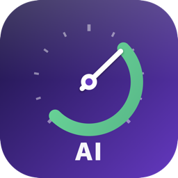

# AI Taskbar

<p align="center">
  
</p>

<p align="center">
  <b>Your LLM subscriptions, quotas and spend — in the macOS menu bar.</b><br/>
  Claude · ChatGPT/Codex · Gemini · Grok · OpenRouter · Z.AI (GLM) · Kimi · DeepSeek · Jev (TypeSafe) · Muse (Meta)
</p>

<p align="center">
  <a href="https://github.com/justoeu/ai-taskbar/releases"></a>
  <a href="LICENSE"></a>
  
  
</p>

A native menu-bar app that answers "how much of my plan have I used, and what
would it have cost?" for ten LLM providers at once. It reads the logins your
CLIs already keep — no API keys to paste for Claude, Codex, Gemini, Grok or
Muse — and everything stays on your Mac: **no telemetry, no account, no
server**.

## Features

**Quota at a glance**
- One gauge in the menu bar shows your **highest utilization** across the providers whose cards are open — collapse a card to leave it out.
- Per provider: plan name, every usage window (5-hour session, weekly, per-model weekly such as Fable, usage credits) with green → yellow → red thresholds and reset countdowns.
- A 24-hour sparkline per provider, and notifications at the thresholds you choose.

**Cost, estimated locally**
- Today's and the last 7 days' cost per provider and **per model**, computed from your CLI logs (Claude Code, Codex, Gemini CLI, Antigravity, Muse, opencode) at the official per-token rates — prompt caching, fast mode and long-context pricing included. See [pricing](docs/pricing.md).
- opencode traffic is attributed to the vendor that billed it, never counted twice.

**Analytics**
- Usage and cost share across providers for Today / Week / Month, a 7-day per-model chart, your busiest day and the change versus the previous period.

**Menu bar**
- **Pin** any provider next to the main gauge to see its own % (weekly and session stacked); click it to jump to its card.

**Several Claude accounts**
- Every Claude Code config folder (`~/.claude`, `~/.claude-work`, …) is found automatically and shown in the same card, with ‹ › to switch. Analytics offers **All** plus one view per account. [Details](docs/providers.md#several-claude-accounts-on-one-mac)

**Limit resets**
- When a window is above 90% and you have an earned reset, the Claude and Codex cards offer **Use reset** — always behind a confirmation, never automatic.

**Service status**
- Live incidents and maintenance from each provider's official status page, in one panel.

**Everyday comforts**
- English, Português (Brasil) and Español.
- Reorder and fold cards, Esc to close, ← / → to switch accounts.
- An in-app update check with a verified, one-click download.

## Install

1. Download the DMG for your Mac from [Releases](https://github.com/justoeu/ai-taskbar/releases):
   `ai-taskbar-X.Y.Z-arm64.dmg` (Apple Silicon) or `ai-taskbar-X.Y.Z.dmg` (universal, Intel + Apple Silicon).
2. Open it and drag **AI Taskbar.app** to **/Applications**.
3. Launch it. Release DMGs are signed and notarized by Apple, so there is no Gatekeeper warning.

**Updates:** the app checks GitHub at launch and once a day, and shows a banner
when a new version exists. The download is checked against the release
checksum and the signing team before the DMG is shown; nothing is installed
without your click. Turn it off with `[updates] enabled = false`.

Prefer building it yourself? See [CONTRIBUTING.md](CONTRIBUTING.md).

## Supported providers

| Provider | What it reads | Setup |
|---|---|---|
| **Claude** | Claude Code's Keychain login | `claude auth login`. Click **Authorize** once if the card asks. Extra accounts are found automatically. |
| **Codex / ChatGPT** | `~/.codex/auth.json` | `codex login` |
| **Gemini** | Antigravity CLI (`agy`), or an API key for a heartbeat only | Run `agy` once to sign in |
| **xAI (Grok)** | Grok CLI login, or a Management API key for team billing | `grok login` |
| **Muse (Meta)** | Muse CLI login | `muse login`, then enable in Settings. Off by default. |
| **OpenRouter** | API key | Settings → OpenRouter |
| **Z.AI (GLM)** | API key | Settings → Z.AI |
| **Kimi (Moonshot)** | API key | Settings → Kimi |
| **DeepSeek** | API key | Settings → DeepSeek |
| **Jev (TypeSafe)** | API key, plus an optional console sign-in for spend | Settings → Jev (TypeSafe). Off until a key is saved. |

API keys are stored encrypted in the config file and bound to this Mac. The app
never refreshes a login it shares with a CLI, so it never logs you out of Claude
Code or Codex. What each card shows, and why, is in
[Provider setup & troubleshooting](docs/providers.md).

## Configuration

Settings live in `~/Library/Application Support/ai-taskbar/config.toml`. Most of
them are in the in-app **Settings**; click **Config** in the popover footer to
edit the file. Missing sections are added on launch and your edits are kept.
The full schema, with comments, is in [`config.example.toml`](config.example.toml).

```toml
[ui]
refresh_interval_seconds = 300   # how often to refresh (minimum 15)
# language = "pt-BR"             # en | pt-BR | es

[thresholds]
warning  = 70                    # bar turns yellow
critical = 90                    # bar turns red

[notifications]
notify_at = [90, 100]            # notify once per window at these percentages
```

## Troubleshooting

| Symptom | What to do |
|---|---|
| Claude card shows **Authorize** | macOS needs your consent to read the Keychain item. Click it and choose **Always Allow**. [Why](docs/providers.md#claude-code-on-macos--keychain-access) |
| A card shows **Re-login** | The provider rejected the login. The button runs the CLI's own login for you. [Authorize vs Re-login](docs/providers.md#oauth-recovery--authorize-vs-re-login) |
| Claude shows `rate_limit_error` | Anthropic throttled the usage endpoint. The card keeps the last reading and backs off on its own. [Details](docs/providers.md#claude-429-rate_limit_error) |
| An API key set in `~/.zshrc` is ignored | Apps opened from Finder don't see your shell environment. Enter the key in Settings instead. [Workarounds](docs/providers.md) |
| Codex credits have no bar | The API reports no total, so the bar appears once spending is observed. [How credits work](docs/providers.md#openai--codex--credits-are-a-quantity-not-money) |
| Gemini or Grok card is locked | Install the CLI and sign in (`agy` / `grok login`). [Gemini](docs/providers.md#google-gemini--antigravity-cli-monitoring--heartbeat) · [Grok](docs/providers.md#xai-grok--supergrok-cli-monitoring--api-team-billing) |
| Muse weekly says "last reading" | Meta omits the weekly window while you are idle; the card keeps the last value until it resets. [Details](docs/providers.md#meta-muse--cli-login-quota-plus-local-token-history) |
| A pin is refused | There is no room left before the notch, or you already have 5 pins. [Pinned LLMs](docs/how-it-works.md#pinned-llms-in-the-menu-bar) |

## Privacy & security

- Runs entirely on your Mac: no telemetry, no analytics, no server of ours. It only talks to each provider's own API and to GitHub (for updates).
- Logins are read, never copied: Claude's stays in the Keychain, and CLI logins are never refreshed or rewritten unless you opt in.
- API keys are encrypted and bound to this Mac; config and cache files are `0600`.
- Configurable hosts are allow-listed, and TLS pinning is available.
- Cached responses keep usage numbers only: account ids and e-mail are stripped from OpenAI's.

The full list, with the limits of each protection, is in
[How it works](docs/how-it-works.md#privacy--security--full-list).

## Learn more

- [Provider setup & troubleshooting](docs/providers.md) — what each card reads, and every recovery path
- [Cost estimates & pricing](docs/pricing.md) — price tables and per-model rules
- [How it works](docs/how-it-works.md) — refresh cycle, caching, status sources, data locations, security
- [Contributing](CONTRIBUTING.md) — build, test, release
- [Release notes](https://github.com/justoeu/ai-taskbar/releases)

## License

MIT — see [LICENSE](LICENSE). Inspired by [`akitaonrails/ai-usagebar`](https://github.com/akitaonrails/ai-usagebar) (Linux/Waybar).
